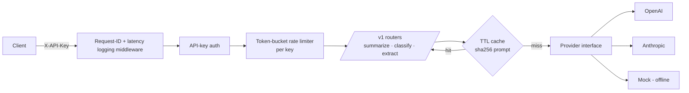

# LLM API Service


 

A **production-style backend** that wraps Large Language Models behind a clean, secure REST API.
It exposes `summarize`, `classify` and `extract` endpoints and handles the things real AI backends need:
authentication, rate limiting, caching, input validation, structured-output parsing, request tracing and
a pluggable provider layer (OpenAI, Anthropic, or an offline mock for tests/CI).

> **Focus:** backend engineering for AI — API design, reliability, cost control and testability.

## Architecture



## Features

| Concern | Implementation |
|---|---|
| Provider abstraction | `LLMProvider` ABC → OpenAI, Anthropic, Mock (swap with `LLM_PROVIDER` env var) |
| Auth | `X-API-Key` header checked against `SERVICE_API_KEYS` |
| Rate limiting | Per-key **token bucket** (`RATE_LIMIT_PER_MINUTE`), returns `429` + `Retry-After` |
| Cost control | TTL cache keyed on `sha256(provider, system, prompt)` – repeated prompts are free |
| Structured output | JSON-only prompts + defensive parsing; invalid model output → `502` instead of bad data |
| Validation | Pydantic v2 schemas with length/range limits → `422` on bad input |
| Observability | `X-Request-ID` propagation + per-request latency logs |
| Quality | 8 pytest tests, GitHub Actions CI, Dockerfile |

## Quick start

```bash
pip install -r requirements.txt
uvicorn app.main:app --reload          # runs with the offline mock provider
# open http://localhost:8000/docs for Swagger UI
```

Use a real model:

```bash
export LLM_PROVIDER=openai OPENAI_API_KEY=sk-...      # or anthropic + ANTHROPIC_API_KEY
uvicorn app.main:app
```

Docker:

```bash
docker build -t llm-api . && docker run -p 8000:8000 -e LLM_PROVIDER=mock llm-api
```

## Example

```bash
curl -X POST localhost:8000/v1/classify \
  -H "X-API-Key: dev-key" -H "Content-Type: application/json" \
  -d '{"text":"I was charged twice, please refund me","labels":["billing","refund","other"]}'
# {"label":"refund","confidence":0.9,"model":"mock-1","cached":false}
```

## Tests

```bash
pytest -q        # 8 passed
```

## Project structure

```
app/
  main.py            FastAPI app, middleware, /health
  config.py          env-driven settings
  security.py        API-key auth + token-bucket limiter
  cache.py           TTL cache
  schemas.py         request/response models
  routers/nlp.py     /v1/summarize, /v1/classify, /v1/extract
  providers/         base.py, openai_provider.py, anthropic_provider.py, mock.py
tests/test_api.py
```

## Interview talking points

- **Why a provider interface?** Avoids vendor lock-in, enables A/B testing models, and lets CI run with zero API cost.
- **Why token bucket?** Allows short bursts while enforcing an average rate; O(1) per request. In production this would move to Redis so limits hold across replicas.
- **Handling non-deterministic output:** constrain via prompt, parse defensively, validate against the allowed label set, fail loudly (502) rather than return bad data.
- **Scaling next steps:** Redis for cache + limiter, async job queue for long documents, streaming responses, OpenTelemetry tracing, token-usage billing per key.
